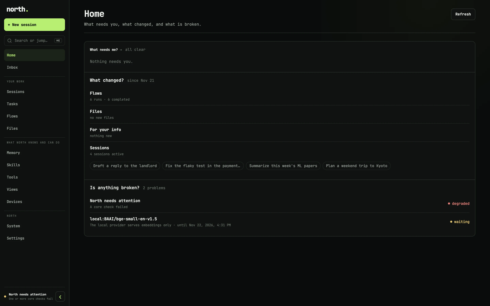

<p align="center">
  
</p>

<p align="center"><b>A digital version of you.</b> An open-source assistant that runs on your computer. It works on your tasks, asks before it changes anything, and learns how you decide, so you can let it decide more.</p>

<p align="center">
  
</p>

## What north does

- **Works on your tasks:** research, writing, files, the web, your browser, and code through Claude Code or Codex.
- **Asks before it changes anything:** each change is a card that shows exactly what will happen.
- **Learns how you decide:** your answer can become a rule, so next time north does not need to ask.
- **Runs on a schedule:** flows such as a morning briefing run by themselves.
- **Stays on your computer:** everything north keeps is in `~/.north`.

The tour, the four modes and every command are on [kushagrabainsla.github.io/north](https://kushagrabainsla.github.io/north/).

## Install

north is built for macOS, and most of it runs on Linux too.

```bash
curl -fsSL https://raw.githubusercontent.com/Kushagrabainsla/north/main/scripts/install.sh | bash
```

Then run `north web` for the dashboard, or `north` for the terminal interface. Setup in the dashboard connects an AI provider and anything else you want. You can skip each step and come back later.

## More

- [Changelog](CHANGELOG.md): what changed, and why
- [Discussions](https://github.com/Kushagrabainsla/north/discussions): ask a question, or share what you made north do
- [Coding style](docs/CODING_STYLE.md): how north's code is written, for anyone changing it
- [MIT License](LICENSE)
