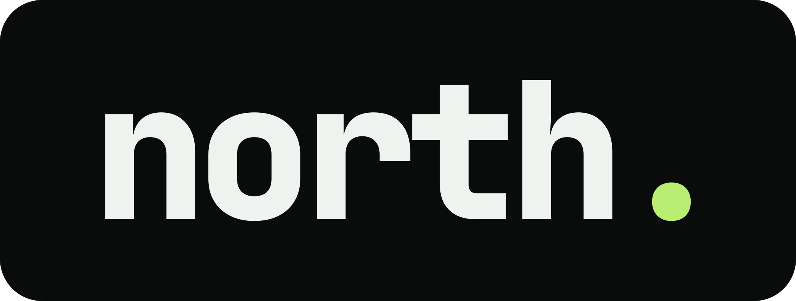

<p align="center">
  
</p>

<p align="center">A digital version of you that learns how you think and earns autonomy over time.</p>

<p align="center"><a href="https://kushagrabainsla.github.io/north/"><b>kushagrabainsla.github.io/north</b></a>: what north does, how it asks before it acts, and every command.</p>

## Install

```bash
curl -fsSL https://raw.githubusercontent.com/Kushagrabainsla/north/main/scripts/install.sh | bash
```

Then open the dashboard with `north web`, or the terminal interface with `north`.

## More

- [Changelog](CHANGELOG.md): what changed, and why
- [Coding style](docs/CODING_STYLE.md): how north's code is written, for anyone changing it
- [MIT License](LICENSE)
