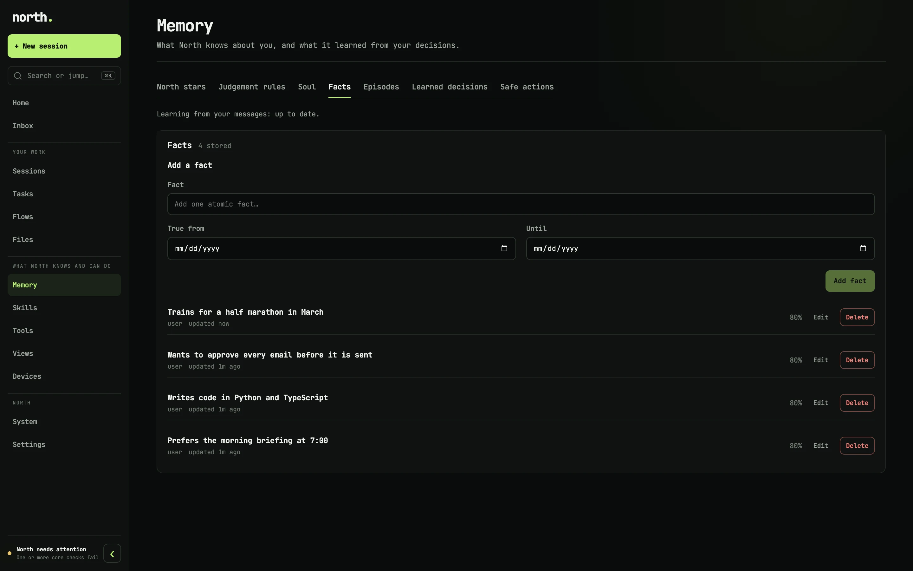
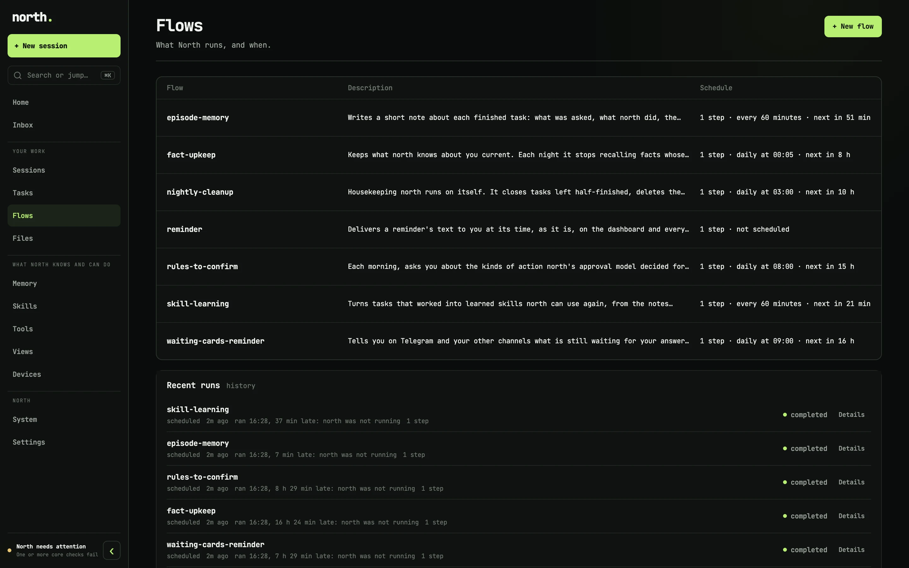

<p align="center">
  
</p>

<p align="center"><b>A digital version of you.</b> An open-source assistant that runs on your computer. It works on your tasks, asks before it changes anything, and learns how you decide, so you can let it decide more.</p>

<p align="center"><a href="https://kushagrabainsla.github.io/north/"><b>kushagrabainsla.github.io/north</b></a>: what north does, how it asks before it acts, and every command.</p>

<p align="center">
  
</p>

## What north does

- **Works on your tasks.** Research, writing, files, the web and your own browser profiles. Tell it what you want in plain words, from the dashboard, the terminal or Telegram.
- **Asks before it changes anything.** Each change comes to you as a card that shows exactly what will happen: the command, the diff, the file, the message. Approve it, reject it, or answer its question.
- **Learns how you decide.** Your answer to a card can become a rule. Next time, north does not need to ask. You choose how much it decides, in one of four modes.
- **Codes in a copy of your repo.** Coding goes to Claude Code or Codex, in an isolated git copy. north runs your tests and offers you the change.
- **Runs on a schedule.** Flows run by themselves: a morning briefing, a nightly check, a reminder. Home tells you what changed while you were away.
- **Writes its own tools.** Ask for something it cannot do yet, and north writes a tool, tests it, and asks you before it switches the tool on.
- **Shows its costs.** Pick a model for each kind of work, or let north choose. north writes down the cost of every run.
- **Stays on your computer.** Your memory, your cards and your history are files in `~/.north`.

<table>
  <tr>
    <td width="50%"></td>
    <td width="50%"></td>
  </tr>
  <tr>
    <td>Memory: what north knows about you, and what it learned from your decisions. You can correct or delete each item.</td>
    <td>Flows: what north runs, and when. Each run is kept, with its steps.</td>
  </tr>
</table>

## Install

north is built for macOS, and most of it runs on Linux too. The installer sets up [uv](https://docs.astral.sh/uv/) and installs north from GitHub.

```bash
curl -fsSL https://raw.githubusercontent.com/Kushagrabainsla/north/main/scripts/install.sh | bash
```

Then open the dashboard:

```bash
north web
```

Setup in the dashboard connects one AI provider (such as OpenRouter, Anthropic, Groq or your OpenAI Codex login), and anything else you want: coding agents, browser profiles, Telegram, your files. You can skip each step and come back later. To use the terminal interface instead, run `north`.

## Learn more

- [kushagrabainsla.github.io/north](https://kushagrabainsla.github.io/north/): how north earns autonomy, and every command
- [Changelog](CHANGELOG.md): what changed, and why
- [Discussions](https://github.com/Kushagrabainsla/north/discussions): ask a question, or share what you made north do
- [Coding style](docs/CODING_STYLE.md): how north's code is written, for anyone changing it
- [MIT License](LICENSE)
